# 课纲智评 v0.2 图文使用说明

## 1. 课纲智评

图文使用说明

从教学大纲到可复核的测评

v0.2.0 · 教师操作 / 学生作答 / 结果复核

2026年10月 · 本地模板演示版

## 2. 第一次使用：启动与登录

准备好 Node.js 24 或更新版本，再打开项目

① 双击根目录“启动课纲智评.cmd”，等待浏览器打开。

② 默认地址：http://127.0.0.1:3210

③ 本地演示密码：teacher-demo-2026。首次生成蓝图时也会提示登录。

④ 使用完毕双击“停止课纲智评.cmd”。关浏览器不会停止服务。

这些截图来自隔离验收环境，截图中端口为3211；日常启动默认3210。系统无需PowerShell启动脚本。仅源码首次运行需联网安装依赖；离线包已含依赖，但仍需Node.js。

## 3. 先用一份示例跑通全过程

教师确认每个关键步骤，学生只看到作答页面

1  输入大纲与考核要求 → 确认教学目标、题型和分值

2  生成试卷 → 审核题目、答案与简答评分标准 → 发布

3  学生作答 → 教师确认简答分值 → 查看学情与补练

模板模式仅覆盖内置“分类模型评价”课程。真实模型按你的安排稍后配置。

截图和分数均为自动化演示数据，不代表真实教师试用、学生能力测量或真实模型效果。原始截图在本说明书同目录的操作截图文件夹。

## 4. 01  认识教师工作台

首页只保留本次操作需要的信息

左侧选择新建测评、我的测评、答卷与学情。

上方三步显示当前进度。

首页直接填写大纲和考核要求，点击“生成考核蓝图”。

右上角始终显示运行模式。尚未登录时，系统先打开登录框，成功后接续原来的生成操作。

## 5. 02  导入或粘贴课程大纲

建议同时写明教学目标、考核范围和职业情境

点击“加载示例”，可恢复内置课程。

点击“导入TXT / MD”，选择UTF-8文本文件。

示例在07-课程样例目录。检查导入后的文字，再填写考核要求。

模板模式请使用内置示例。其他课程需要真实模型；导入文件不会自动理解任意课程。输入在当前标签页暂存，刷新可恢复。

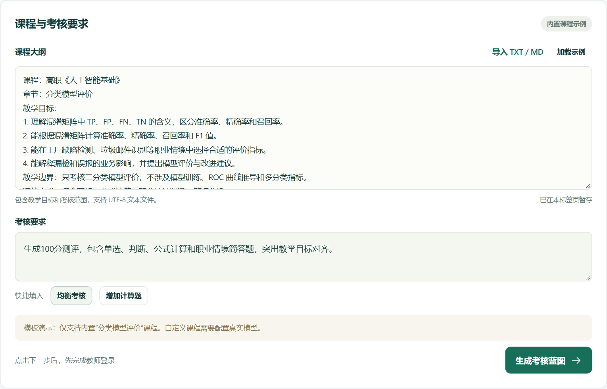

## 6. 03  教师登录后继续生成

首次点击生成，无需重新找回原操作

输入教师密码，点击“进入工作台”。

本地演示密码已在页面提示。

登录成功后自动生成蓝图。密码不正确时在弹窗中修改后重试。

若本机.env修改过TEACHER_PASSWORD，以自己的配置为准。重启服务后可能需要重新登录。

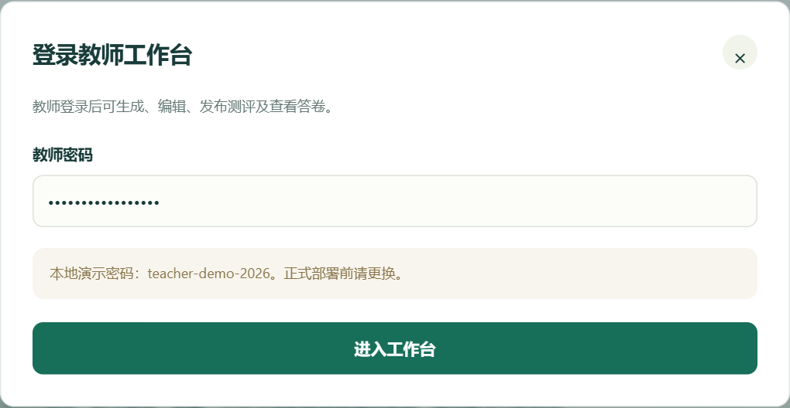

## 7. 04  核对题型、题数和总分

先决定考什么，再生成题目

可修改测评标题、总分，以及每行题型、题数、单题分值。

每行选择教学目标与认知层次。

确认小计之和等于总分，再点击“生成试卷”。

默认示例为9题100分：4道单选40分，2道判断10分，2道计算30分，1道简答20分。可添加或删除计划；演示题库只支持既有题型与目标组合。

## 8. 05  检查目标与原文依据

展开教学目标，确认考核内容没有偏离大纲

点击“查看与编辑教学目标及原文依据”。

目标名称可以修改；下方显示对应的大纲依据。

修改后检查各题型计划的目标映射，再收起此区域。

依据用于帮助教师核查来源，不等于系统已经完成教学有效性论证。当前示例覆盖概念辨析、指标计算、职业情境选择、业务影响分析。

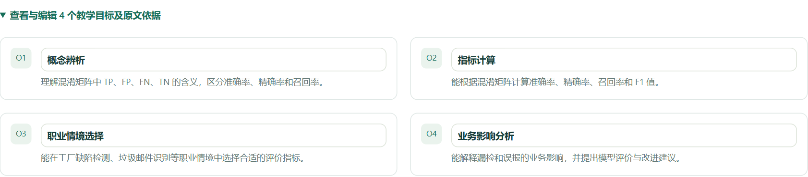

## 9. 06  分值不一致时怎样修正

系统会拒绝生成，并说明具体差额

截图把一行单题分值从10改成11，使合计变成102分。

将该行改回10，或合理调整其他行，让计划合计与目标总分一致。

再次点击“生成试卷”，无需重填大纲。

这是一张真实错误校验截图。高级选项中的复现种子用于模板模式；相同输入和种子可复现模板题目，不代表真实模型逐字可复现。

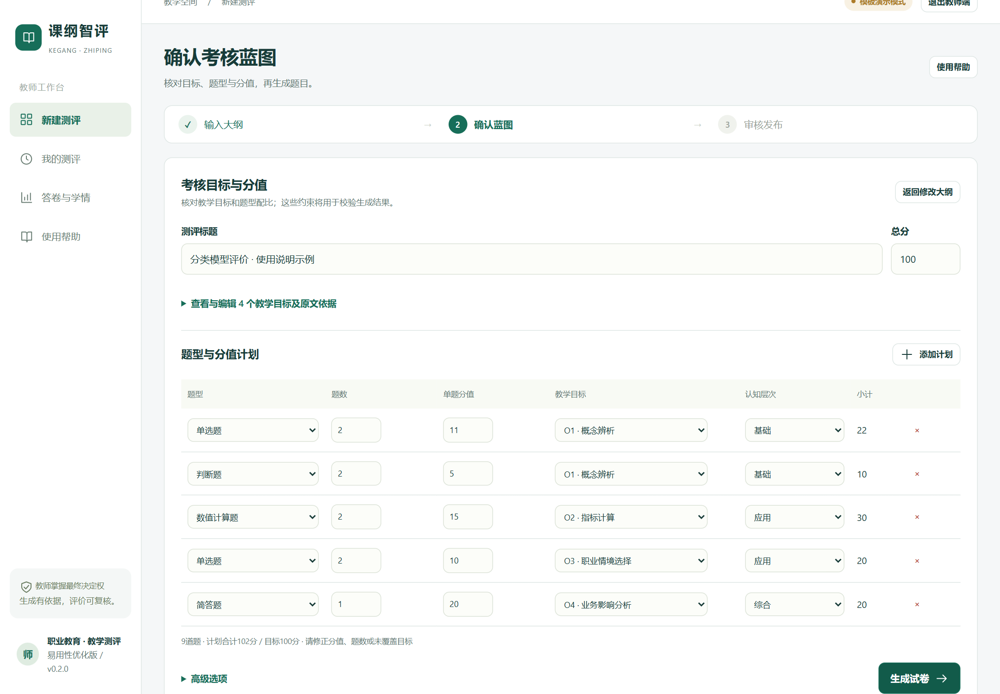

## 10. 07  逐题审核，按题号定位

系统校验通过后，仍由教师判断内容是否适合教学

右侧题号快速跳到对应题目。

检查题干、目标、分值、公式、参考答案和解析。

点击题目旁“编辑”，修改后保存。生成试卷已保存在本机。

编辑后的保存会再次校验。草稿修改不会改变此前已经发布的试卷快照；需要修改学生看到的卷子时，请审核后重新发布并使用新链接。

## 11. 08  审核公式与参考答案

数值题的公式、答案及容差需要一起检查

LaTeX由本地KaTeX渲染，离线也可显示。

编辑公式时不需要外层美元符号。

非法公式会阻止保存。修改正确后可继续保存。

数值题请核查题干中的TP、FP、FN、TN与参考答案一致。学生数值输入支持小数、分数和百分数，按题目的绝对误差容限评分。

## 12. 09  用表格填写简答评分标准

直接填写评分要点、关键词和分值，无需编辑JSON

每行写一个明确的评分要点。

匹配关键词用中文或英文逗号分隔。

各行分值合计须等于本题分值。向下滚动后点击保存。

示例三行6+6+8=20分。关键词只产生建议分，不能理解否定、推理质量或同义表达；实际分数仍由教师复核。编辑窗口可以纵向滚动。

## 13. 10  确认审核，再发布

发布前完成教师确认

点击“审核并发布”。

检查本次试卷信息，勾选审核确认。

点击发布按钮，生成独立的学生试卷快照。

发布后的链接对应当时的题目和答案快照。后续编辑原草稿不回写旧快照。请在发布前特别检查答案、分值与简答标准。

## 14. 11  打开学生作答链接

当前版本在本机完成演示

从发布结果中打开学生页面，或复制链接。

也可点击进入学情页面，之后从那里打开学生页。

127.0.0.1只指向当前电脑；直接把链接发到另一台设备无法访问。

截图是端口3211的隔离验收实例，日常启动默认端口3210。跨电脑教学使用需要另行部署与验证访问权限。

## 15. 12  学生填写昵称并作答

学生页面不提供教师端的答案与编辑入口

打开学生链接，填写演示昵称。

单选、判断直接选择；计算题输入数值；简答题输入文字。

页面底部显示已答题数，便于检查漏答。

演示时请使用虚构昵称，不需要录入真实身份信息。学生端接口已验证不返回标准答案。

## 16. 13  提交前检查全部题目

确认作答进度达到9 / 9，再提交

逐题完成后，检查已答题数。

本浏览器会暂存本份未提交答卷；刷新后可继续。

确认无遗漏，再点击底部提交按钮。

截图是一份预设演示答卷：一题计算故意答错，简答题待教师确认。暂存不等同于已提交，请以提交成功页面为准。

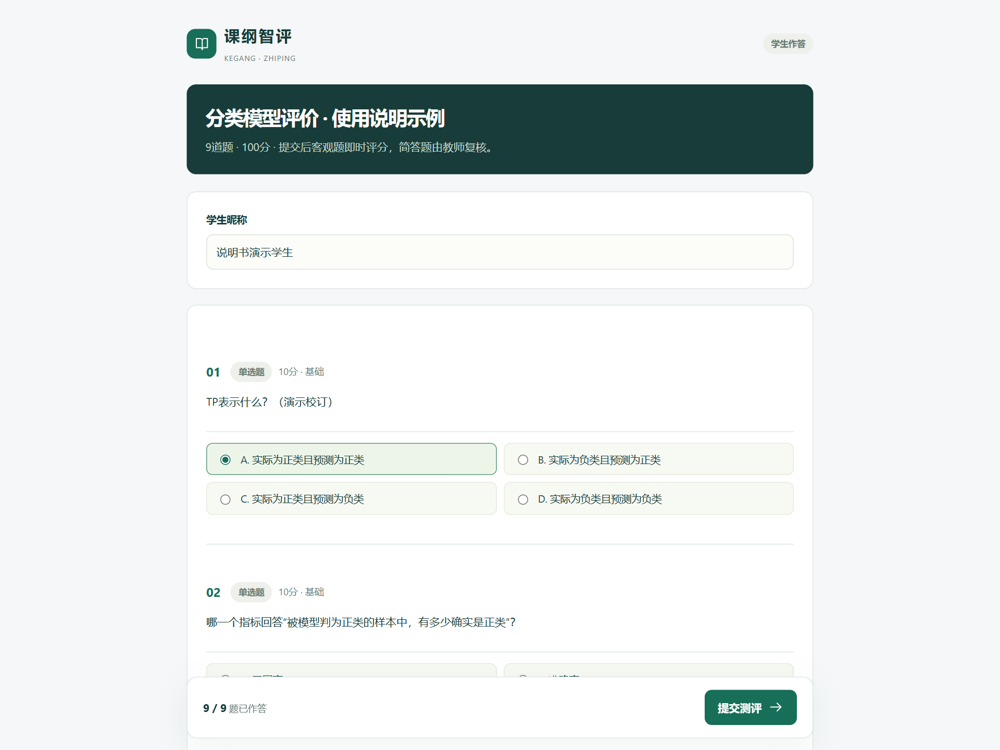

## 17. 14  看到“答卷已提交”才算完成

提交后查看当前评分状态

页面显示提交结果。

客观题按规则评分；包含简答题时会提示等待教师复核。

未复核的简答分不应当作最终成绩。

自动建议分与教师确认分不同。演示截图不反映真实学生表现，也不证明评分系统理解完整语义。

## 18. 15  教师查看待复核答卷

进入“答卷与学情”，选择对应测评

从下拉框选择已发布的测评。

学生提交后点击“刷新数据”。

查看“待复核”数量，点击答卷行的“查看答卷”。

已确认均分只统计完成教师复核的答卷。尚无完成复核的答卷时显示横线，不把待复核分数混入均值。

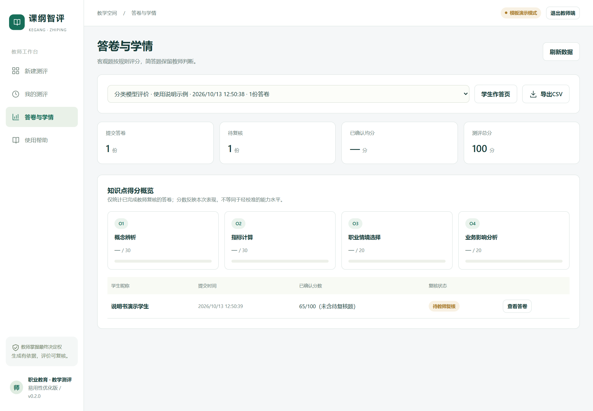

## 19. 16  结合学生推理确认简答分

逐条检查建议分，填写教师确认分值

向下找到简答题，阅读学生作答、评分要点及参考答案。

在“教师确认分值”中填写得分，示例输入18分。

点击答卷底部“保存教师复核”。

若关键词出现但含义相反、推理错误，教师应调整建议分。最终分数必须在0至该题满分之间。截图中的18分是人为设定的演示复核结果。

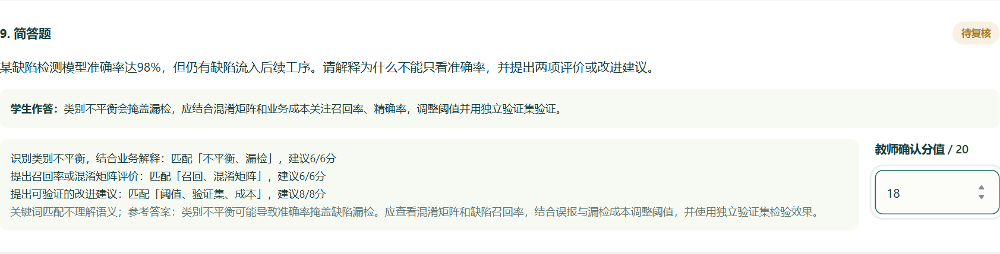

## 20. 17  查看确认后的学情

示例答卷复核后为83 / 100

确认“待复核”减少，状态变为“已完成”。

查看已确认均分和各知识点得分。

这些指标描述本次试卷表现，不等同于经过校准的能力测量。

示例为客观题65分，加简答教师确认18分，总计83分。自动化同时验证了报告接口与CSV导出的分数。

## 21. 18  根据薄弱知识点安排补练

完成复核后，补练入口才可使用

在答卷底部点击“查看补练建议”。

依据知识点表现选择建议练习。

教师可结合学生解释，安排讲解与再次练习。

当前补练为已发布原题的规则回练，不是实时生成的新题，也不自动形成新的学习效果证据。

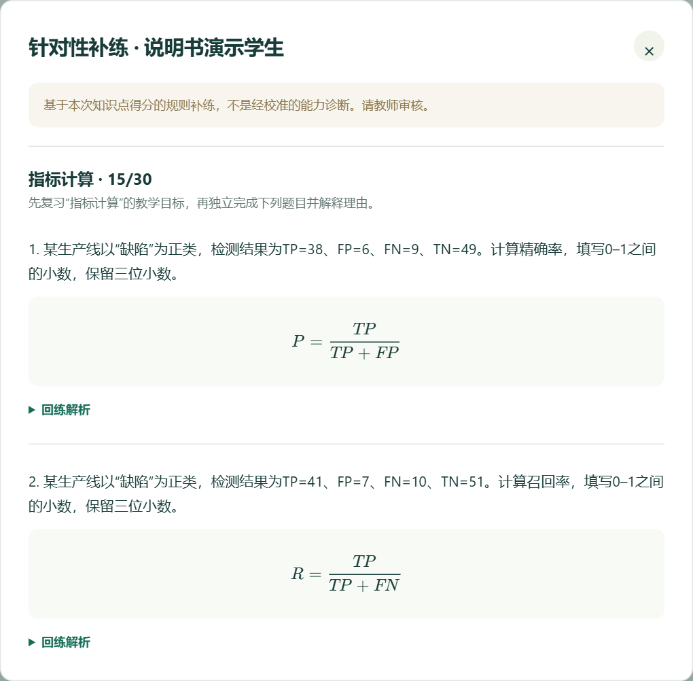

## 22. 19  从“我的测评”继续编辑

生成后的草稿保存在本机数据库

左侧点击“我的测评”。

根据标题、题数和更新时间选择草稿。

点击“继续编辑”，恢复试卷审核界面。

输入与蓝图暂存在当前标签页；生成后的试卷、已发布快照和答卷存入SQLite。关闭标签页可能清除尚未生成的输入草稿。备份前停止服务并复制data目录，勿公开其中的学生数据。

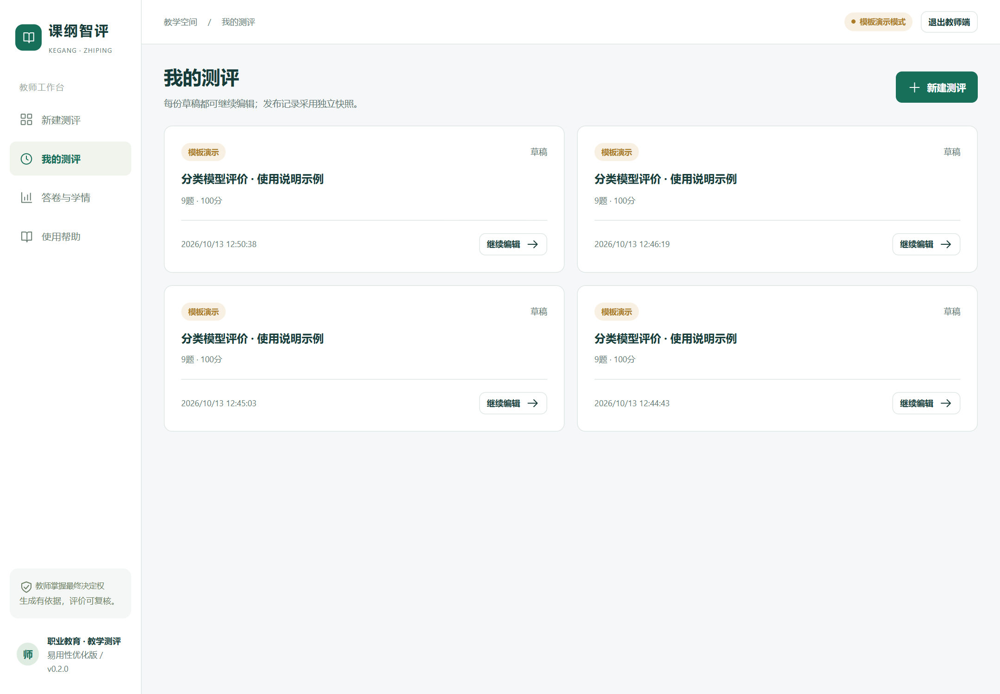

## 23. 20  打印与导出各有什么用

试卷审核页展开“打印与导出”

打印：生成不含标准答案的学生卷，可在打印窗口另存为PDF。

教师版JSON：包含完整题目、答案与评分标准，用于备份与审查。

成绩CSV：在“答卷与学情”导出，便于表格分析。

教师版JSON含答案，不发给学生。CSV需要结合复核状态理解分数，推荐完成复核后再导出。

## 24. 21  操作忘记时打开“使用帮助”

系统内也提供流程、保存规则与模式说明

随时从左侧进入“使用帮助”。

按教师操作流程检查当前步骤。

说明书文件存在时，页面提供“下载图文使用说明PPT”入口。

该说明书放在09-使用说明目录，与源码目录同级。移动文件时保留目录结构，才能从系统内下载。

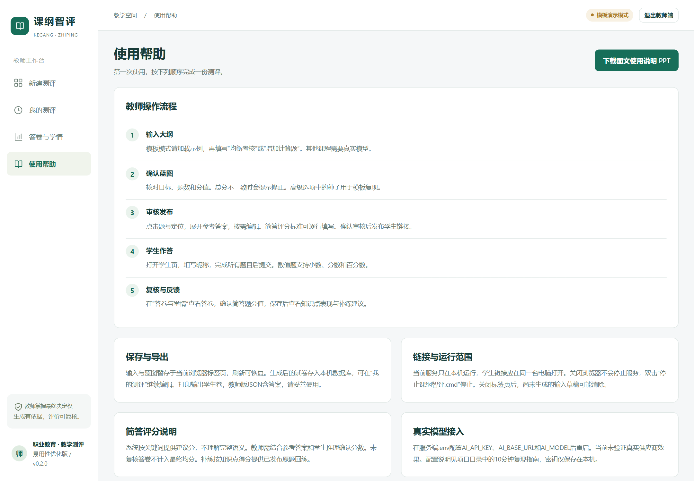

## 25. 22  小屏浏览与纵向操作

窄屏会调整导航和内容布局

导航可横向滑动，页面内容纵向阅读。

长蓝图表格在自身区域横向查看。

出题和逐题审核更适合电脑；本截图用于验证390px布局。

手机样式可在浏览器开发工具中查看；当前本机127.0.0.1服务不能直接由另一台手机访问。手机布局验证不等同于跨设备部署验证。

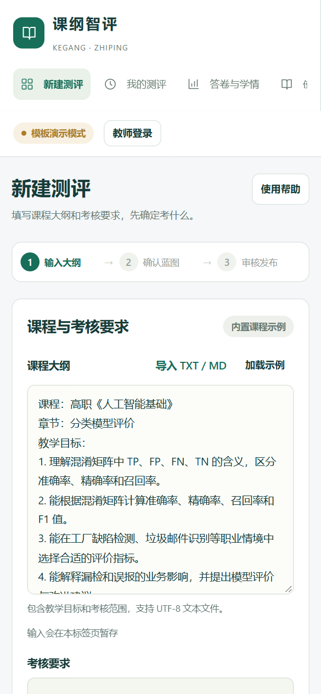

## 26. 打不开、登录失败或内容丢失时

先按具体症状排查，不修改杀毒软件设置

打不开网页：重新双击启动CMD，保留窗口中的错误；查看01-应用源码/data/server-error.log。

启动环境：确认Node.js版本至少24。当前启动器直接使用Node.js，不需要start.ps1。

登录失败：检查本机.env的TEACHER_PASSWORD；重启后重新登录。

找不到内容：生成过的试卷到“我的测评”查找；未生成的输入只在原标签页暂存。

端口占用时，启动器会提示。可停止本项目已有实例，或在.env更换PORT。不要结束不属于本项目的进程。模型配置问题留待后续接入时验证。

## 27. 参赛前，还需要补齐哪些材料

软件与说明书已迭代；提交材料仍要逐项核实

稍后接入真实模型：验证真实课程输入、输出约束与失败案例，记录实际效果。

导出至少3个核心功能的完整AI交互链；工程摘要不能替代原始对话。

按原文准备5–8分钟1080p MP4，包含至少2分钟真实AI协同展示。

核实最新赛事要求与仓库评审权限；补充真实教师反馈和新电脑复现记录。

要求依据06-报名与提交清单/赛事要求原文.txt。原文存在日期等冲突，最终以组委会最新通知为准。本说明书不声称作品已满足所有最终提交条件。
