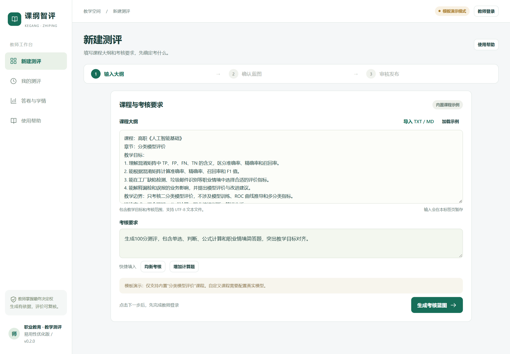
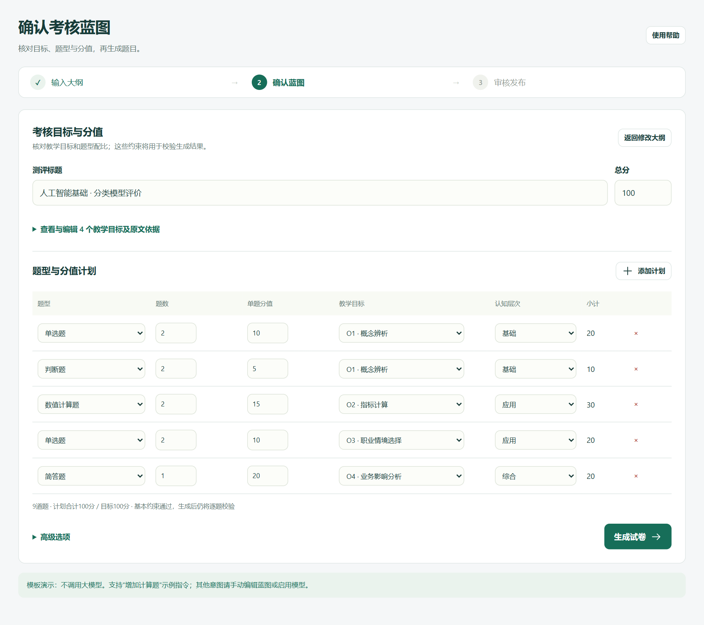
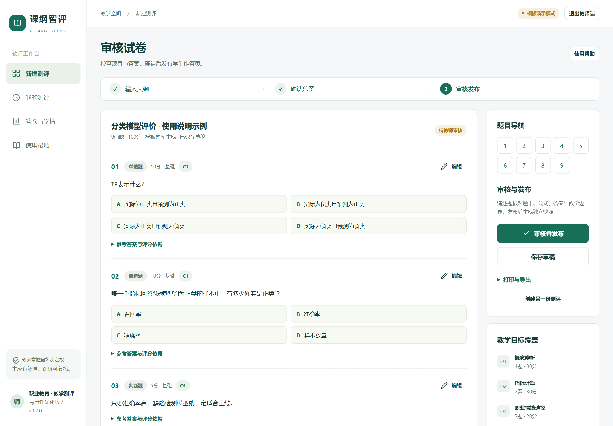
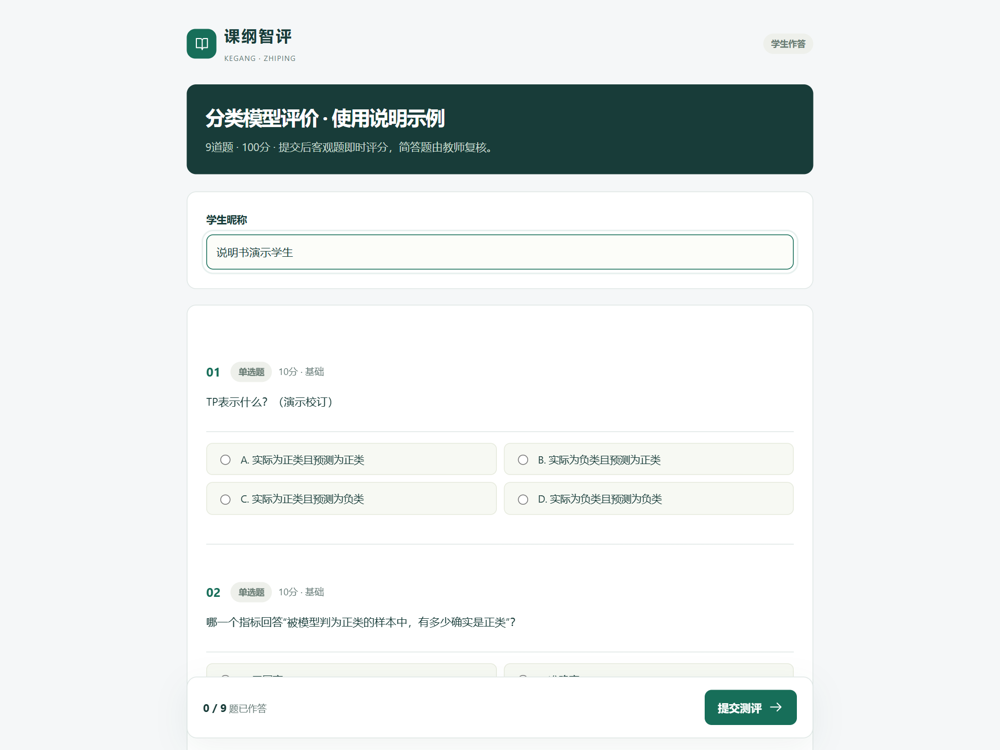
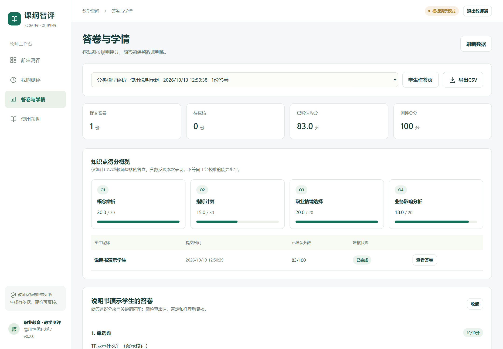

# 课纲智评作品介绍

### 面向职业教育的自然语言测评生成与学情反馈平台

全国计算机应用能力与数字素养大赛
第九届传智杯 AI 创新应用挑战赛省赛预指导

命题范围 4  低代码与智能表单生成引擎
作品版本 v0.2.0  |  材料整理日期 2026年10月29日

课纲智评将教师输入的大纲和考核要求转成可审核的考核蓝图，再按题目结构生成试卷编辑页与学生作答页。教师可以完成出卷、公式检查、审核发布、答卷复核和知识点反馈，减少在题目文本、排版工具与收集表单之间重复整理的步骤。

### 本版交付状态

已实现本机运行的完整测评流程和真实模型接口。默认模板演示无需模型密钥；真实模型需由使用者配置后实测。当前简答题采用量规关键词建议并由教师确认，尚未提供经验证的语义评分或自适应能力测量。

## 一 项目详情与应用场景

### 面向教师的章节测评

本项目面向职业教育教师的课前诊断、章节练习和课后巩固。教师不仅需要题目，还需要明确每道题对应的教学目标、题型与分值，检查公式和参考答案，并在作答后形成可追溯的反馈。产品把这些环节组织为同一套工作流程。

初始示例选择《人工智能基础》中的“分类模型评价”，覆盖混淆矩阵、精确率、召回率和工厂缺陷检测情境。示例用于展示职业情境与知识计算的结合，尚未由真实任课教师审定为正式课程大纲。

| 使用角色 | 主要任务 | 系统提供的支持 |
| --- | --- | --- |
| 教师 | 确定考核目标与审核结果 | 大纲输入、蓝图调整、试卷编辑、发布与复核 |
| 学生 | 完成已发布测评 | 按题型填写答案，提交后查看允许展示的反馈 |
| 评审或试用者 | 复现作品流程 | 本地启动入口、课程样例、PPT、测试与技术材料 |

### 与命题范围的对应

系统将自然语言需求转换为结构化蓝图与题目 JSON，再用固定组件动态渲染为可编辑、可发布、可收集答案的工具页面。教师无需编写页面代码。现阶段支持四种题型和教学测评这一垂直场景，未实现任意业务页面的通用低代码搭建。

### 完整流程

输入大纲与需求 → 确认考核蓝图 → 生成并审核试卷 → 发布学生表单 → 学生作答 → 客观题评分与简答复核 → 查看目标得分与补练建议。发布时保存独立快照，后续修改草稿不会改变已经发布的试卷。

## 二 安装启动与模式配置

### 本机演示启动

1. 将完整 ZIP 解压到普通本地文件夹，不要直接在压缩软件内运行。准备 Node.js 24 或更新版本，并确保 node 命令可用。交付包附带运行依赖与公式资源，不包含 Node.js 安装程序。

2. 双击根目录“启动课纲智评.cmd”。浏览器打开后访问 http://127.0.0.1:3210；若浏览器未自动打开，可手动输入该地址，并查看启动窗口的提示。

3. 点击“教师登录”，本地演示密码为 teacher-demo-2026。加载示例大纲，按下一页流程体验。结束时双击“停止课纲智评.cmd”；仅关闭浏览器不会停止服务。

4. 已保存数据位于 01-应用源码/data。交付包不携带本机已有答卷、运行日志或密钥；评审首次启动时会创建独立数据。当前学生链接也只能在运行服务的同一台电脑上访问。

### 真实模型接入方式

将 01-应用源码/.env.example 复制为 .env，填写 AI_API_KEY、AI_BASE_URL、AI_MODEL，停止并重新启动程序。文件名不能带 .txt 后缀。所选服务需兼容 /chat/completions，并支持 JSON 对象输出；接口地址由程序自动追加 /chat/completions。

API 密钥仅保存在本机服务端配置中。真实请求会向所配置的供应商发送课程大纲、考核要求或已确认蓝图；使用前应确认资料可用于该服务。程序会明确返回接口或结构校验错误，不会将失败请求替换成模板结果。

### 模式与排错

| 情况 | 处理方式 |
| --- | --- |
| 模板演示 | 使用内置分类模型评价示例及支持的要求；不把固定题库视为大模型输出。 |
| 端口打不开 | 保留启动窗口提示，检查 Node.js 与 data/server-error.log；不要结束其他项目的进程。 |
| 模型请求失败 | 检查接口地址、模型名、密钥与额度；每次请求超时上限为90秒。 |
| 需要还原模板 | 清空 AI_API_KEY 并重启，避免环境变量中仍保留该配置。 |

## 三 输入大纲并确认蓝图

在“新建测评”中粘贴课程大纲，或导入 UTF-8 的 TXT、MD 文件。填写考核要求，例如总分、重点技能和职业情境，然后生成蓝图。模板演示请先点击“加载示例”，使用“均衡考核”或“增加计算题”等已有示例要求。

### 核对目标与分值

展开目标详情，查看与大纲原文的对应；调整题型、题数和分值，确保计划合计等于目标总分。系统支持单选、判断、数值计算、简答四种题型。默认示例为9题、100分；蓝图最多30题。

出现总分不一致提示时，修正对应计划行后继续生成，无需重新输入大纲。来源摘录和目标覆盖校验可帮助教师查找问题，但不能单独证明题目符合教学要求。

## 四 审核题目与发布试卷

生成试卷后，使用右侧题号导航逐题检查题干、选项、公式、答案和解析。展开参考答案与评分依据，确认数值题单位、误差范围以及简答题评分点。编辑完成后保存草稿，再执行“审核并发布”。

发布生成独立试卷快照和学生链接。可打印学生卷，也可导出包含参考答案的教师版 JSON；教师版文件不应发给学生。历史草稿可在“我的测评”继续编辑。

## 五 学生作答与学情反馈

打开发布后的学生页面，填写演示昵称，按题型完成作答后提交。单选与判断按标准答案计分；数值题支持小数、分数和百分数，并按设置的误差范围比较。

教师进入“答卷与学情”，检查简答题关键词建议分、参考答案和学生实际表述，确认或调整分数后保存。未复核答卷不计入最终确认均分。知识点报告按目标统计得分，补练提供薄弱目标相关的已发布原题。

## 六 项目亮点

### 可审核的生成过程

教师先确认目标与分值，再生成题目，避免直接接受一份难以追溯的长文本试卷。蓝图把目标、题型、数量、难度和来源对应起来，程序检查总分与目标覆盖，教师保留内容判断权。

### 从题目内容到可用表单

试卷与学生作答页面共享结构化题目数据。题型决定输入组件，公式字段决定公式渲染，发布快照保证作答版本稳定。自然语言生成结果可以进入收集与反馈流程，无需教师手动重建表单。

### 数学公式与职业情境结合

题目可包含独立 LaTeX 公式、计算容差和职业情境说明。内置样例用工厂缺陷检测解释精确率与召回率，使计算、概念辨析和业务选择在同一份测评中出现。

### 评分结果可解释并可复核

客观题评分采用明确规则，简答题展示量规与关键词匹配建议。教师确认后才计入最终结果，避免把词语命中直接解释为学生理解。当前补练基于目标得分选择原题，不声称完成个体能力估计。

### 本机演示可复现

模板模式使用固定样例和种子，附带课程输入、试卷示例、运行依赖与截图。评审可以先复现完整流程，再配置模型测试其他课程。界面采用三步主流程、折叠详情、题号定位和输入暂存，降低操作中断后的重复填写。

### 效果评价计划

后续教师试用将记录出卷准备时间、实质修改率、内容错误与目标覆盖情况。目前没有真实教师试用样本或对照研究，因此不报告节省时间百分比、学习成绩提升或测评效度结论。

## 七 AI测试技术落地使用情况

### 模型在产品中的使用位置

真实模型接口用于两步任务：将大纲与自然语言要求转换为考核蓝图；根据教师确认的蓝图生成题目、答案、解析和简答量规。输入按资料 JSON 传入，提示词限定职业教育角色与输出结构。生成结果经过领域规则校验后才能进入编辑与发布流程。

### 开发与测试中的 AI 协同

开发过程采用 AI 辅助模块拆分、代码生成、测试与错误修复，并保存阶段记录、提示词模板和本地 Git 历史。AI 生成的测试建议通过实际执行验证；工程摘要不等同于原始聊天记录，也不代替完整的人机交互证据。

| 验证层次 | 已验证内容 | 证据与边界 |
| --- | --- | --- |
| 模型接口契约 | 请求字段、JSON解析、非法输出、HTTP错误和缺少模型名 | 本地模拟服务；未调用真实供应商 |
| 领域约束 | 蓝图总分与来源、公式、选项、评分、学生答案隔离 | 自动化规则验证；不证明教学内容正确 |
| HTTP流程 | 登录、生成、编辑、快照、提交、教师复核和重启持久化 | 使用隔离数据完成流程测试 |
| 启动器 | 等待打开命令、备用浏览器、失败提示、信号退出 | 自动化测试覆盖分支 |
| 浏览器验收 | 导入、错误修正、打印导出、移动布局、完整作答复核 | 已有实际界面截图与验收JSON |

已有2026年10月29日测试记录显示16项测试通过，包含12项核心与接口测试及4项浏览器启动测试。完整作品包还附交付时的复验记录。测试证明软件规则和流程在测试条件下成立，不代表真实模型出题质量或真实课堂效果。

后续真实模型验收应保存供应商与模型版本、课程输入、输出、教师修改和失败案例，分别检查格式合规、知识正确、目标对应与耗时。当前尚无这些实测结果。

## 八 关键技术与实现边界

| 技术或模块 | 实现方式与作用 |
| --- | --- |
| 前端动态渲染 | HTML、CSS、JavaScript 按蓝图和题目 JSON 渲染四种题型、教师编辑与学生作答页面。 |
| Node.js与SQLite | Node.js 24 HTTP服务；内置 SQLite 保存草稿 papers、发布快照 exams、答卷 attempts。 |
| 模型接口 | lib/ai.mjs 构建提示词，调用兼容 chat/completions 接口，要求 JSON 输出并执行校验。 |
| 领域规则 | lib/domain.mjs 检查计划分值、目标、选项、答案类型、量规及公式；处理客观题评分与报告。 |
| 公式处理 | KaTeX 0.16.22 解析与显示 LaTeX，公式资源随包提供。保留第三方许可证。 |
| 状态与权限 | 教师会话鉴权；学生接口移除答案；发布快照独立于可编辑草稿；标签页暂存未完成输入。 |

### 输入与数据保护

服务端采用输入长度和请求体限制、请求频率限制、参数化 SQL、Host 与变更请求 Origin 校验。前端转义文本，KaTeX 禁用 trust；CSV 导出处理公式前缀。密钥从服务端环境或 .env 读取，不写入学生页面和提交包。

### 当前部署范围

服务只监听本机 127.0.0.1，默认密码用于本地演示。尚未提供公网访问、多人教师账户、考试防作弊、生产并发保障或经验证的语义评分。公开部署需要另行补充 HTTPS、账号与权限、数据备份及容量验证。

作品不执行模型返回的任意网页脚本，而是在已定义的组件与规则中使用结构化输出。数学语法有效不等于计算与教学内容正确，最终由教师审核。

## 九 发表获奖与优化说明

### 此前发表或获奖情况

截至本次省赛预指导提交，本项目未发表，未获奖。

### 项目来源与原创部分

依据项目开发记录，本作品从空目录建立业务代码，未以完整开源测评平台作为二次开发底座。原创实现范围包括课程大纲到蓝图的流程、题目结构与校验、教师编辑发布、答卷收集、规则评分和目标反馈。通用运行环境、KaTeX 公式库及其字体属于第三方组件，并保留许可说明。

本项目不是基于其他项目优化的作品。文中 v0.1 至 v0.2 的变化属于本项目自身开发过程中的版本迭代。

### 在本项目第一版基础上的优化

| 优化部分 | v0.2中的具体变化 |
| --- | --- |
| 操作流程 | 三步工作台突出输入大纲、确认蓝图、审核发布，折叠低频详情。 |
| 编辑体验 | 增加题号导航，简答量规改为逐行表单；修复非法公式校验失败后继续编辑保存的问题。 |
| 中断恢复 | 输入、蓝图和作答在当前标签页暂存；登录后接续生成。已保存试卷使用数据库持久化。 |
| 启动体验 | 不依赖原 PowerShell 启动脚本；等待浏览器打开命令，失败尝试备用浏览器并保留手动网址提示。 |
| 文档与验证 | 提供27页图文PPT、22张操作截图、技术PDF、测试记录及可校验的作品压缩包。 |

上述优化延续同一参赛项目的 v0.1 版本，区别于对其他完整项目的包装。完整开发过程见02-开发过程记录，第三方组件边界见01-应用源码/THIRD_PARTY_NOTICES.md。

## 十 交付内容与评审复现

| 材料位置 | 内容 |
| --- | --- |
| 00-提交导读.md | 解压启动方法、材料索引、当前状态及视频提交说明。 |
| 作品介绍文档 | 本介绍PDF与可编辑文字版，按本次表单七项内容组织。 |
| 01-应用源码 | 前后端源码、运行依赖、配置模板、测试与第三方许可。 |
| 02-开发过程记录 | 真实阶段记录、修复记录、运行提示词与Git日志。 |
| 03-技术文档 | 技术PDF、可编辑说明、10分钟复现指南。 |
| 04-演示视频材料 | 讲解脚本、录屏清单与配图；不是已录制的视频。 |
| 05-测试与验证 | 测试记录、界面截图、浏览器验收与试用方案。 |
| 06-报名与提交清单 | 赛事原文、预指导表单要求、提交索引与待办。 |
| 07-课程样例 | 大纲、蓝图、完整试卷及演示作答说明。 |
| 08-交付包 | 本地开发历史bundle及验证工具；不重复套装旧ZIP。 |
| 09-使用说明 | 27页PPT、文字操作说明及22张实际截图。 |

建议先阅读本介绍，再按“二 安装启动与模式配置”运行；用内置示例完成蓝图、出卷、发布、作答和复核。需要查看详细操作时打开09-使用说明中的PPT。

本次预指导表单要求完整作品上传主流网盘，作品介绍单独上传，演示视频填写B站、抖音等可公开访问的视频链接。截止时间按用户提供的表单为2026年10月31日15:00；预指导提交不替代省赛正式作品提交。
